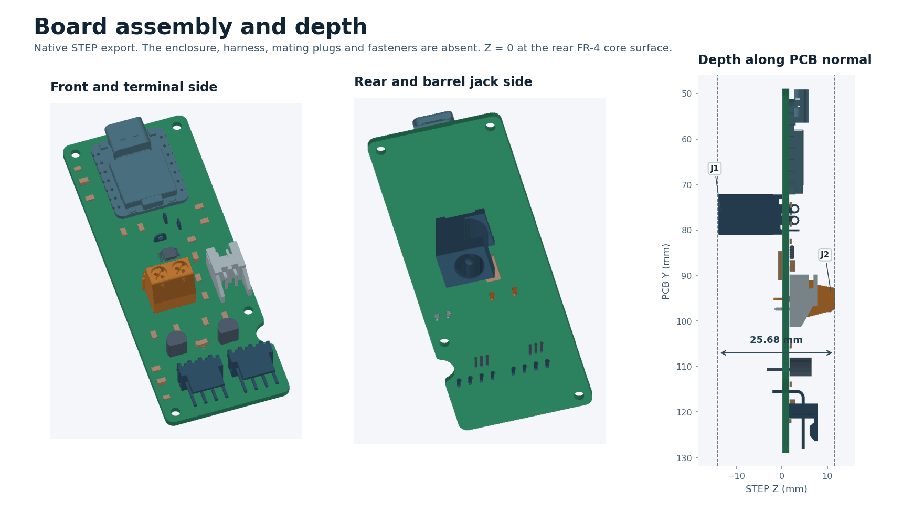
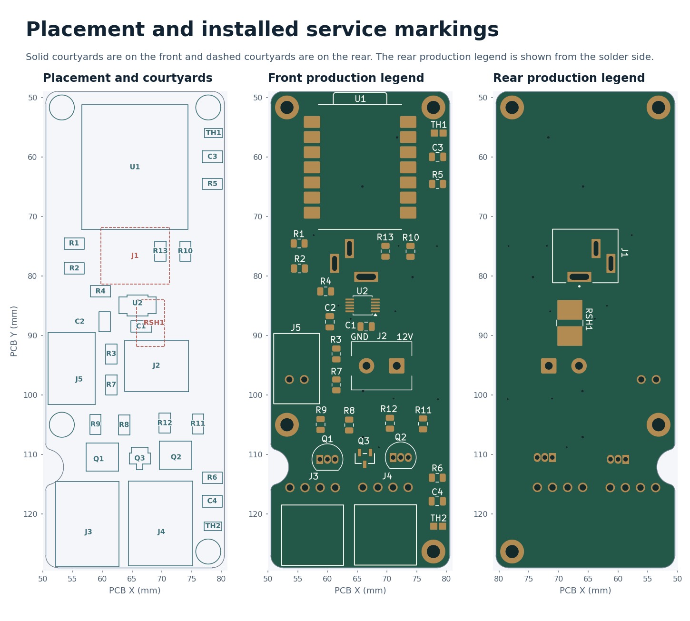
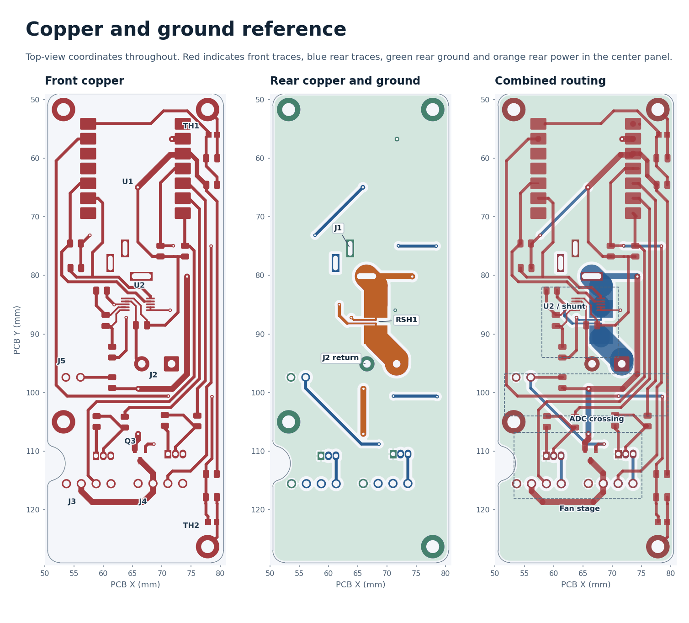
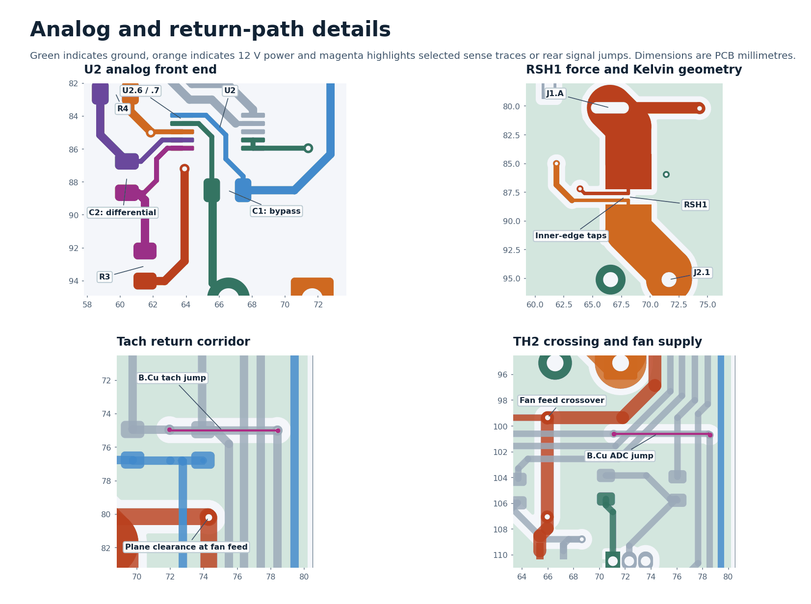

# CENMATE fan controller — PCB layout and placement review

November 20, 2026 · full-of-beans/cenmate-fan-controller · initial-schematic

**REVIEWED_COMMIT** de06c7e533a6dcbbc7722b4ecfde4b6cad392dfc

## Executive summary

**7.3/10 · Advanced hobbyist / prosumer.** The power routing, Kelvin pickups and functional floorplan would hold up well in a professional review of a constrained two-layer prototype. The INA228 bypass loop would draw the strongest electrical layout critique. Avoidable cuts in the rear ground reference, tight hand-soldering geometry at Q1/Q2 and sparse installed service markings keep the board below professional-quality release polish.

**A bare-board engineering prototype can proceed without a copper edit.** Keep the selected 1 oz green process and check the shop's CAM rendering of the Q1/Q2 webs and J1 slots. **Resolve the mechanical envelope before ordering a fit-required prototype.** The fresh populated STEP measures **25.68 mm along the PCB normal**, from the J1 jack to the J2 terminal. If both modeled extremes count along the fan-depth axis, the assembly already exceeds 25 mm by 0.68 mm. The installed panel datum, cable and backplane geometries are unavailable.

The highest-value copper change for a revision is to bring C1 to U2 pins 6 and 7 with a short local return. Follow it with a compact C2/R3/R4 input group, then improve rear reference continuity in selected regions.

## 1. Baseline and method

The GitHub branch and fetched Git ref independently resolved to the full SHA above. The immediate parent, 8cc880a96dea908ae958eecb40e3e9b91f2e8c4f, has the same design. The branch tip adds the November 19 audit. All checks below used a detached checkout of the reviewed SHA. Earlier audits supplied context. [November 12](pcb-layout-audit-2026-11-12.md) · [November 15](full-design-audit-2026-11-15.md) · [November 17](fabrication-readiness-followup-2026-11-17.md) · [November 19](final-preorder-audit-2026-11-19.md).

| Evidence | Method and result |
| --- | --- |
| Electrical connectivity and board rules | KiCad **10.0.8** with matching symbol and footprint tables. Stored-fill and in-memory-refill DRC each returned **0 board violations, 0 unconnected items and 2 schematic parity warnings** for missing Manufacturer fields on U1/J5. Fresh ERC returned 0. XML netlist and IPC-D-356 cross-check found 30 fitted references, 88 schematic pin/pad assignments and 26 net groups. PCB-derived procurement fields also differ for U1/J5. |
| Routes and plane | Parsed native footprints, pads, tracks, vias and stored zone. Projected selected front centerlines onto rear ground fill. Reported route lengths use planar trace centerlines and pad centers, excluding vertical via length. Plane projection and section widths identify possible return detours. |
| Manufacturing geometry | Regenerated seven Gerbers and two drill files. The repository checker verified continuity after plating, pad and route inventories, edge/mask geometry and 39 plated features, including 14 vias and three slots. Gerbonara warned about the Excellon G90 header position and successfully parsed both drill files. |
| Mechanical and visual | Exported populated STEP from the pinned PCB, measured native solids in FreeCAD 1.0.0 and inspected model views, both copper layers, overlay, placement/courtyards and plotted legend. KiCad CLI raster rendering crashed in this environment. The assembly figure uses the fresh STEP mesh. |

Reproduce with the pinned [PCB](../../hardware/fan-controller.kicad_pcb), [schematic](../../hardware/fan-controller.kicad_sch), [project settings](../../hardware/fan-controller.kicad_pro) and [custom rules](../../hardware/fan-controller.kicad_dru). Commands were **pcb drc --format json --schematic-parity --severity-all** with and without **--refill-zones**, **sch erc --format json --severity-all**, **pcb export ipcd356**, **sch export netlist --format kicadxml**, **pcb export svg --mode-single --fit-page-to-board** and **pcb export step**. The repository includes the [parity checker](../../scripts/check-schematic-pcb-parity.py), [CAM exporter](../../scripts/export-pcb-manufacturing.sh) and [CAM checker](../../scripts/inspect-pcb-manufacturing.py). Git 2.56.1, Python 3.12.14, Shapely 2.2.0 and Matplotlib 3.10.8 supported the review.

No physical unit, backplate CAD, vendor CAM decision, scope data or temperature data was available. Coordinates are PCB X/Y in mm, viewed from the front with Y increasing downward. STEP Z = 0 is the rear FR-4 core surface. Proposed placement windows are concepts requiring rerouting, zone refill and fresh verification. Return and loss estimates are based on geometry and nominal material properties. They do not quantify measured noise or temperature rise.

## 2. Mechanical constraints and design intent

The 30 × 80 mm outline spans X 50.5–80.5 and Y 49–129, with a left relief around Y 112.1. Finished stack is **1.60 mm nominal**, including 1.51 mm FR-4, 35 µm copper per face and nominal 10 µm mask per face. U1 origin X = 65.481 is within 0.019 mm of the centerline. U1 sits at the top, and J3/J4 share the bottom with pin rows only 0.04 mm apart in Y. Keep the overall arrangement and every existing connector's face and mating direction.

**PCB-relative result.** The difference between J2's +11.595 mm extreme and J1's −14.085 mm extreme is **25.680 mm**, projected on STEP Z perpendicular to the board. It spans both faces and already includes the board thickness. The extrema occur at different in-plane locations.

**Installed depth remains unresolved.** If the permitted 25 mm is a slab parallel to the PCB and both extrema must lie inside it, the modeled parts exceed the limit by 0.680 mm before tolerances and mating hardware. Translating the board cannot fix that case. If the 25 mm starts at the rear-panel fan mounting datum and J1 may protrude outward through the cutout, measure only the inboard extent from that datum. With +Z inward and the two axes parallel, J2's modeled inboard depth is 11.595 mm minus the datum's Z coordinate in this STEP frame. J2 alone meets 25 mm when the datum is at or above Z = −13.405 mm. That threshold excludes plugs, cable bends, joints, leads, fasteners and tolerance. Register the actual panel and the assembly before concluding pass or fail.

| Ref / region | Verified evidence | Installed check |
| --- | --- | --- |
| J1 (65.50, 76.65), rear | Tensility 54-00286, Z min **−14.085 mm**. Three plated slots. | Barrel nose, seated plug and panel opening relative to the fan datum. |
| J2 (69.10, 95.10), front | Phoenix **5442206**, Z max **+11.595 mm**. Body X 64.03–74.76, Y 91.10–99.20. | Tool approach, wire exit and bend, body support during tightening. |
| J3/J4, front, Y ≈ 115.5 | Molex 0022053041 placeholders reach +7.77 mm Z and Y 128.10/128.06 unmated. | Check actual MODDIY lead pattern, keying, pin map, retention and mated wire egress before translating anything. |
| J5 (56.10, 97.40), front | JST XH 2.50 mm pitch. Body X 51.15–58.55 and Z max +7.695 mm. C2 body starts at X 59.775, a 1.225 mm projected separation. | Actual side-entry housing, wire bend and subsequent access to C2. |
| U1 (65.481, 61.757), RSH1 (68.10, 87.90) | U1 USB model ends at Y 49.189. Rear shunt model projects 0.885 mm below the core. Real shunt body can be **1.3 mm** high before joint/tolerance allowance. | USB insertion and actual underside clearance. Gauge rear shunt, lead ends and solder against the SATA shoulders and backplane. |
| H1/H3 (53.20/77.80, 51.70), H2 (77.80, 126.30), H4 (53.20, 105.00) | Four grounded Ø2.20 mm plated holes with 4 mm lands. | Compare H4 to the historical X = 53.00 insert reference. A 0.20 mm misalignment would exceed nominal 0.10 mm M2 radial clearance. Verify head, washer, relief and chassis bonding. |

Mechanical sources [Phoenix J2](https://www.phoenixcontact.com/en-us/products/printed-circuit-board-terminal-bc-508x10-2-gn-5442206) · [Tensility J1](https://tensility.s3.us-west-2.amazonaws.com/imports/product_spec_sheets/54-00286.pdf) · [JST XH](https://www.jst.com/wp-content/uploads/2025/06/eXH.pdf) · [Bourns RSH1](https://www.bourns.com/docs/product-datasheets/crf.pdf) · [Fan header selection](../../README.md).

## 3. Component placement

| Group | Assessment |
| --- | --- |
| U1, H1–H4 and J1–J5 | The long board supports a clear top-module, middle-power and bottom-fan layout. J1, RSH1 and J2 are tightly grouped along the main supply route. Keep all connector mating directions, including the module USB. Respect mated-body and tool keepouts when considering component moves. |
| U2, C1, C2, R3/R4, RSH1 | U2 is already close to the rear shunt in projected XY. C1 sits below/right of U2's left-side supply pins and its leads wrap around the part. C2 lies to the left, correctly between the two filter resistors and the IC. R3/R4 straddle C2 vertically by 10.5 mm. Solve bypass and input placement together before moving U2 or RSH1. |
| R1/R2 and R10/R13 | R1/R2 line up beside the left I²C path and use a rear feed for 3.3 V. R10/R13 share an F.Cu supply lane just below the FAN2 tach hop. These taps are reasonable. Move either pair when a new position shortens a branch or improves plane coverage. |
| Q1/Q2, R8/R9/R11/R12 | Repeated orientation and short rear collector escapes make the channels readable. Passives have clear zoning above the drivers. Inspect the drivers before the tall headers obstruct access. |
| Q3/R7 | Q3 is between the transistor stages and close to the fan power split. R7 is about 13.3 mm away, at the gate and fan-feed branch points near J5 and J2. Place it by the Q3 gate and source if editing this area. This shortens the bias stubs while retaining the rocker route. |
| TH1/C3/R5 and TH2/C4/R6 | Sensor bodies are about 66.05 mm apart in compact groups along the right edge. Grounds reach H3 and H2 respectively over front copper. Preserve sensor positions until airflow and temperature measurements can distinguish the effect of fan discharge, the U1 module and grounded mounts. |

No courtyard overlap was reported. Courtyards describe bare footprint work space. Rework access with the mating housings, connector leads and fasteners in place remains a physical check.

## 4. Routing on both layers

**Front.** 211 trace segments total **685.28 mm**. Most signals use 0.50 mm, U2 necks to 0.25–0.30 mm and fan power uses 1.00 mm in open regions. A 0.75 mm upper branch supplies R5. I²C leaves U1 on the left and stays on F.Cu. PWM commands leave on the right and reach both driver channels without layer changes. The tradeoffs include a 62.75 mm J3–U1 FAN1 tach route and a 94.66 mm TH2 ADC route. Most bends use 45° geometry. Sub-0.08 mm segments near several pads and two unused 5 V stubs at U1.14 totaling 0.033 mm are cleanup opportunities. Inspect pad and finer-width transitions as part of actual reroutes. Blanket bend replacement offers little value.

**Rear.** 31 segments total **98.80 mm**. The main 12 V path stays on this layer without a series via. B.Cu also carries short PWM collector paths, the Q3 gate route, Kelvin launches and signal/power crossovers. Using plated leads to connect each fan's short collector path is efficient. The 6.47 mm FAN2 tach and 7.49 mm TH2 ADC jumps remove more ground width than their 0.50 mm traces because the zone clears foreign-net copper by a nominal 0.50 mm.

**Rules.** Global minima include 0.20 mm clearance, 0.20 mm track width, 0.30 mm copper-to-edge, 0.50 mm via diameter and 0.30 mm through drill. Actual vias are 0.60/0.30 or 0.80/0.40 mm. Q1/Q2 have a 0.10 mm local pad clearance override, with 0.12 mm actual. The U2 rule requests 0.20–0.25 mm track width and 0.20 mm clearance by footprint reference. Some free segments at U2 exceed the nominal cap while DRC passes. Clarify rule scope when reworking the escape if a specific maximum width is needed. The project also retains an unused 5V_DIODE_IN netclass pattern. [Project rules](../../hardware/fan-controller.kicad_dru) · [KiCad 10 CLI](https://docs.kicad.org/10.0/en/cli/cli.html).

## 5. Ground reference and return paths

The single B.Cu ground region occupies **2,020.81 mm²** in the saved fill. Fresh CAM confirms continuity after plating and no disconnected ground island. Two of the 14 vias are GND. Other layer transfers use circuit or mounting pads.

| Circuit | Geometry and assessment |
| --- | --- |
| J2.2 to J1.C | Both terminals have solid access to B.Cu ground. At Y = 80.15 the main corridors measure 13.20 and 4.90 mm. At Y = 87.90 they measure 11.04 and 11.51 mm. The return can flow around the force copper without a via-only connection. |
| U1 and I²C | U1.13 uses under 2 mm of front trace to its local via (71.70, 56.74). The I²C paths have rear reference for much of their length. Roughly the last 3 mm of SDA spans the rear HDD feed clearance near U2.4, and SCL crosses that power region too. Rerouting at U2 should consider that discontinuity. |
| PWM and tach | Front PWM controls run to paired transistors. Each collector uses about 5 mm of rear trace to its fan header and has a nearby grounded emitter and header ground. FAN2 tach traverses B.Cu from (71.95, 74.95) to (78.40, 75.00), narrowing the outer rear corridor to about 1.00 mm at Y = 75. FAN1 tach crosses rear clearances near Y = 101.55. |
| Thermistor ADC | TH1 spans about 23.44 mm on the front. TH2 transitions at (71.10, 100.60) and (78.55, 100.70). The outer right rear corridor is 1.26 mm wide at Y = 100. C4 lies about 90.31 routed mm from U1.2. Check ADC readings as fans change state. If needed, place the ADC filter at the receiving end and improve reference coverage. |
| INA228 return | U2.1/.2 address ground reaches the via at (71.40, 85.95). Supply ground at U2.7 reaches C1.2 over 5.38 mm of front copper. Another ~7.0 mm of front copper connects C1.2 to the grounded plated J2.2 pad. The capacitor's local loop closes across U2.6 and U2.7. The J2 segment is the plane connection for that ground branch. |

A ground via by a signal hop is helpful when it ties a real front reference conductor or patch to connected rear ground. First shorten or relocate the hop. Preserve a common reference. Avoid indiscriminate stitching or splitting the plane into analog and digital halves. Plane geometry identifies potential detours, with coupling still to be measured. [TI INA228 layout](https://www.ti.com/lit/ds/symlink/ina228.pdf) · [Analog Devices grounding guidance](https://www.analog.com/en/resources/faqs/faq_dds_digital_and_analog_gnd_planes.html).

## 6. Power distribution and sensitive analog

**HDD force path.** J1.A → /12V_IN → RSH1.2 → RSH1.1 → /12V_HDD → J2.1. Four 4.0 mm segments total 11.28 mm. Two 3.0 mm segments total 1.40 mm within the shunt lands and do not create a narrow exposed neck. At 35 µm and 20 °C the centerline estimate is ~1.62 mΩ copper before shunt, return, solder and contacts, or ~11 mV copper drop at 7 A. J1 is rated **7 A**. The 9 A supply and broad tracks do not establish current margin for the jack or mating plug during startup. Qualify connector current, heating and source/harness fault protection before powering the full enclosure. [Tensility J1 specification](https://www.digikey.com/en/products/detail/tensility-international-corp/54-00286/16649077).

**Fan branch.** Fans take power upstream of RSH1. About 44.43 mm of 1 mm copper connects J1.A to Q3.2 through three layer changes. The rear feed leg between (65.98, 99.35) and (65.95, 107.05) crosses the TH2/tach routing band in projection. Q3.3 feeds both ports with a short 1 mm split. A coordinated reroute could remove a crossover or reduce ground cuts. No steady-state fan feed bottleneck was demonstrated.

**Kelvin geometry.** RSH1 is the two-terminal Bourns CRF2512-FZ-R001ELF. Each force trace serves an outer pad edge and each sense branch leaves an inner edge. Lands are 3.10 mm axial × 4.00 mm transverse with a **1.30 mm inner gap**, matching the supplier pattern. The 0.30 mm sense traces have **0.30 mm** separation on their parallel segment. Individual paths are 14.77 mm from RSH1.2 to R3.1 and 13.47 mm from RSH1.1 to R4.1. Preserve that pickup topology. Shared termination/solder spreading and thermal EMF remain calibration effects. Characterize zero and gain under actual load and fan activity before changing lands. [Bourns CRF pad layout](https://www.bourns.com/docs/product-datasheets/crf.pdf).

**INA228.** C2 is 100 nF across IN+ and IN− after the two 10 Ω resistors, giving ~79.6 kHz nominal differential filtering. C2→U2.10/.9 routes are **5.23/3.89 mm**. C1 is a 100 nF supply bypass. C1.1→U2.6 (VS) and C1.2→U2.7 (GND) run **6.93/5.38 mm**. The longer traces raise loop inductance and reduce high-frequency bypass effectiveness, increasing susceptibility to ripple across VS and GND. The remote plane connection at J2.2 can also couple load-return disturbances at the shared reference. HDD return current has a solid rear-plane path between J2.2 and J1.C. The narrow front spur connects the analog ground branch to that plane and carries no series HDD return current in the intact design. The geometry suggests a noise-margin and measurement-repeatability concern. Ripple, conversion error and device malfunction have not been observed or quantified.

For a revision, place C1 on F.Cu immediately west of pins 6/7. Use a vertical 0805 with VS toward pin 6 and GND toward pin 7, starting around X 61.5–62, Y 83–84. Connect each pad directly to its pin with short tracks, bring the 3.3 V feed to C1.1 and place a GND via next to C1.2/U2.7 into continuous B.Cu fill. Keep the J2.2 plane connection intact. Move R4 locally if needed to clear its courtyard and escape. Verify the proposed window with copper refill, DRC and soldering access. On the prototype, measure VS directly across pins 6 and 7 with a short-ground probe and compare shunt readings with an independent current reference during fan and HDD load changes. [TI INA228 §§8.1.4, 9 and 10](https://www.ti.com/lit/ds/symlink/ina228.pdf).

## 7. Assembly, inspection and legend

- **Q1/Q2.** The 0.75 mm holes on 1.27 mm pitch leave 0.20 mm minimum rings, 0.12 mm mask webs and 0.52 mm hole-wall spacing. The rings exceed JLCPCB's 0.18 mm absolute limit and fall below its 0.25 mm recommendation for two-layer 1 oz. Nominal webs exceed the 0.10 mm green 1 oz limit by 0.02 mm. Obtain order-specific CAM acceptance and inspect both faces after hand soldering. A staggered footprint can buy margin if actual leads allow it. [JLCPCB process limits](https://jlcpcb.com/capabilities/pcb-capabilities).
- **U2.** The 0.50 mm-pitch pads give usable optical access before tall parts are installed. Locate pin 1 from the assembly drawing. Inspect all ten joints before installing through-hole connectors. Tented vias and no dedicated probe pads limit in-circuit access. A GND/3V3/I²C probe group would help future service.
- **TH1/TH2.** Each 0603 NTC sits on 1.00 × 0.97 mm lands with 0.47 mm gap. These are larger and closer than the reflow example. Control paste and inspect for bridging, tombstoning and stress. [Murata NCU18](https://www.mouser.com/pdfDocs/ncu18.pdf).
- **Assembly sequence.** Reflow small front SMDs, including U2, and inspect. If hand-placing U1 and rear RSH1 afterward, omit U1's 14 apertures from the front stencil and omit a rear stencil. Install tall through-hole parts after inspection. Reconcile U1/J5 procurement fields and actual fan header choice before board-derived assembly data is released. [U1/J5 metadata finding](final-preorder-audit-2026-11-19.md#final26-001--u1j5-procurement-fields-removed-during-footprint-updates).
- **Legend.** J2's 12V/GND use 1.0 mm characters and 0.15 mm strokes. Minimum front ink-to-mask clearance is 0.20 mm. Some front reference strokes are 0.12 mm. Rear RSH1 has 0.127 mm strokes and approaches its land opening to **0.08452 mm**. No ink overlaps plotted openings. Keep the helpful J2 polarity and add fan/switch identifiers, visible pin marks and revision ID in open space. Use at least 1.0 mm text height and 0.15 mm stroke where practical, reposition the RSH1 reference and review both faces with actual plugs in place. [JLCPCB legend limits](https://jlcpcb.com/capabilities/pcb-capabilities).

## 8. Prioritized findings

P1 indicates an engineering concern, P2 a significant layout improvement, P3 professional polish and P4 optional aesthetics. P1 timing depends on the affected release stage.

| ID / class | Location and current condition | Change and expected benefit | Costs, constraints and timing |
| --- | --- | --- | --- |
| **PL01 · P1** | J1/J2, X 60–75, Y 72–100. Modeled Z span 25.68 mm, missing installed datum and mates. | Register actual parts and panel from the fan datum. Include tolerances, harness and backplane. Resolve whether the board can meet 25 mm. | Verification needs no reroute or relocation. A confirmed overshoot needs a lower-profile stack consistent with all mating directions and U1/fan placement. **Before fit-required order.** |
| **PL02 · P1** | J1.A/J1.C (66.50,80.15)/(63.70,75.40), /12V_IN and GND. Jack is 7 A. No carrier fuse, reverse-polarity protection or clamp. An open main return can divert current through shared grounds. | Check startup current, plug drop and temperature, harness protection and the actual main and auxiliary return paths. | Measurements need no layout edit. Protection or connector changes require new electrical/mechanical review. **Before full-load operation.** |
| **PL03 · P2** | C1/U2.6/.7/J2.2, X 63–68, Y 83–96, 3V3/GND. Long bypass legs and remote plane connection. | Try C1 immediately west of pins 6/7, around X 61.5–62 and Y 83–84. Put local ground via next to the cap/return into solid B.Cu. Shorten both legs. | C1 move and reroute, likely R4 move. Same face/profile. Verify VBUS/input escape, solder access and J5 envelope. Window is illustrative. **First copper change on a revision.** |
| **PL04 · P2** | C2/R3/R4/U2.9/.10, X 58–64, Y 82–94, U2 Vin±. Input filter correctly connected but spread out. | Rotate and move C2 close to pins 9/10. Cluster the two resistors on the shunt side of C2. Reduce loop area while preserving the force/sense breakouts. | Move passives and reroute. Check rear clearances if moving vias and J5 work space. Coordinate with PL03 and keep mating directions fixed. **Next revision unless measurements justify sooner.** |
| **PL05 · P2** | FAN2 tach X 72–78.4/Y 75, TH2 X 71.1–78.55/Y 100.6–100.7, FAN1 tach near Y 101.55. Rear cuts under long routes. | Seek a shorter FAN2 crossing near the pull-ups. Evaluate TH2 and fan-feed crossings together. Consider an ADC-side C4 if readings respond to fan edges. | Reroute and possibly move pull-ups or C4. Keep U1 centered, TH2 endpoint fixed and J2/J5 clearance. Refill after each trial to catch displaced cuts. **Next revision if justified.** |
| **PL06 · P1** | Q1/Q2, X 58.7–73.6, Y 110.49–110.80. 0.12 mm web, 0.20 mm ring. | Obtain CAM approval and inspect the joints. If CAM rejects it, evaluate staggered leads/holes for more ring and web. | Review needs no edits. A footprint change requires local reroute and actual lead, solder-side and backplane fit checks. **Before fabrication.** |
| **PL07 · P3** | J3/J4/J5 and RSH1, X 51–75, Y 86–128. Limited service ink and a 0.08452 mm rear gap. | Label connectors, pin 1 and GND where visible, add revision and move the RSH1 reference. Faster, less ambiguous assembly and diagnosis. | No component move or copper reroute. Verify mated visibility. **Low risk before fabrication if artwork is already open.** |
| **PL08 · P3** | R7/Q3, X 61–69, Y 97–111, Net-(Q3-G) and /12V_IN. R7 sits away from the device. | Evaluate R7 near Q3's gate and source, starting above the device near X 66–68, Y 106–108. Shorter bias stubs improve grouping. | Move R7, reroute and recheck J2 access and rocker switching behavior. **Next revision with fan power work.** |
| **PL09 · P3** | U1.14 near (73.56,54.14), U2 and the project rules. Unused 5 V stubs, limited rule scope and no dedicated probe pads. | Remove stubs during routine edits, clarify width rules and add reachable 3V3/GND/I²C test pads. | Minor routing and new pads, no existing component move expected. Check mask and U1 underside clearances. **Next revision.** |
| **PL10 · P4** | J3/J4 0.04 mm Y offset, R1/R2 0.05 mm X offset and small pad entry differences across the board. | Align flexible passives during an unrelated, justified reroute. | No standalone edit. Connector movement carries fit cost for no visible service benefit. **Skip.** |

## 9. Recommendations in order of value

1. Close the J1/J2 installed envelope and check the actual J3/J4 plugs, H4 insert and backplane. Hold a fit-required order until resolved.
2. Put C1 by U2 pins 6/7 with a local return. This is the first copper change for a revision.
3. Tighten the C2/R3/R4 input group when the U2 area is open. Preserve the shunt lands and pickups.
4. Shorten the FAN2 tach and TH2 ground-plane cuts when a revision or measurements warrant it. Validate using actual refilled copper.
5. Obtain Q1/Q2 CAM approval and improve service markings if artwork is revised. Defer lead-pattern changes until CAM or assembly evidence warrants them.

Preserve the main force route, RSH1 pattern, top-centered U1, bottom fan pair and connector mating directions. Retain sensor endpoints unless measurements justify a change. Avoid blanket stitching, a split ground, unnecessary Kelvin width increases, propagation-delay matching of the shunt traces and cosmetic rerouting of sound escapes.

## 10. Professional layout scorecard

| Category | Weight | Score | Board evidence |
| --- | ---: | ---: | --- |
| Electrical layout and grounding | 30% | 7.2 | Direct force route, separate Kelvin pickups and connected reference. Remote U2 bypass return and local rear gaps. |
| Component placement | 20% | 7.9 | U1, fan pairs, sensors and HDD path follow packaging. The U2 passive group and R7 can be tighter. No deduction for fixed mating directions. |
| Routing quality and consistency | 20% | 7.5 | Deliberate widths, mostly direct routing and good rear escapes. Rear crossovers and the long TH2 path merit targeted refinement. |
| Assembly and manufacturing polish | 15% | 7.0 | Reworkable prototype and accessible U2 before tall parts. Q1/Q2 webs and rings, NTC paste geometry and underside fit reduce margin. |
| Silkscreen and documentation | 10% | 6.5 | Clear J2 polarity and detailed design records. Sparse connector IDs, thin strokes and tight rear legend clearance. |
| Overall visual craftsmanship | 5% | 7.7 | Orderly progression from the top module to the power cluster and paired fan stages. The local analog work earns more than alignment tweaks. |
| **Weighted total** | **100%** | **7.325 → 7.3** | **Advanced hobbyist / prosumer** for a mechanically constrained two-layer board. |

**Final assessment.** A professional reviewer should be comfortable with the routing architecture and would ask for the installed depth drawing, a tighter local INA228 bypass on a revision and first-article electrical and assembly evidence. There is little value in a cosmetic reroute before a bare-board prototype. For a board that must install cleanly on the first try, resolve the 25 mm datum and mated fit before ordering. That decision stands independently of DRC and the score.
